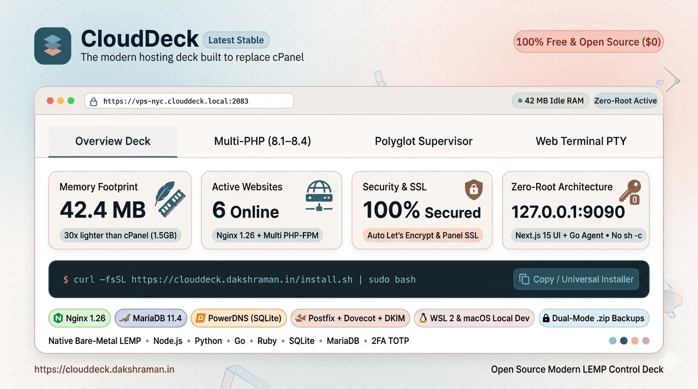

# CloudDeck

<p align="center">
  
</p>

<p align="center">
  <strong>The modern, blazing-fast, open-source cPanel alternative built for 2026.</strong><br />
  Websites, multi-PHP (8.1–8.4), polyglot app runtimes, MariaDB, production email, PowerDNS, 1-click panel SSL, and backups — all from one elegant deck, consuming <strong>under 50MB of idle RAM</strong> without ever exposing a root process to the browser.
</p>

<p align="center">
  <a href="https://github.com/dakshraman/clouddeck/releases"></a>
  
  
  
  <a href="https://github.com/dakshraman/clouddeck/stargazers"></a>
  <a href="https://github.com/dakshraman/clouddeck/issues"></a>
  <a href="#license"></a>
</p>

<p align="center">
  <a href="https://clouddeck.dakshraman.in">Website</a> ·
  <a href="#quick-install">Quick Install</a> ·
  <a href="#why-clouddeck--comparison-matrix">Comparison Matrix</a> ·
  <a href="#whats-new-in-v0624--v0625">What's New</a> ·
  <a href="docs/">Docs</a> ·
  <a href="docs/api.md">API Reference</a> ·
  <a href="docs/deployment.md">Deployment Guide</a> ·
  <a href="docs/architecture.md">Architecture</a> ·
  <a href="docs/cpanel-parity.md">cPanel Parity</a> ·
  <a href="SECURITY.md">Security Policy</a>
</p>

---

## ⚡ Quick Install

Run this single command on a fresh **Ubuntu** or **Debian** VPS (x86_64 or arm64) with root access:

```bash
curl -fsSL https://clouddeck.dakshraman.in/install.sh | sudo bash
```

> **Fallback via GitHub Releases:**
> ```bash
> curl -fsSL https://github.com/dakshraman/clouddeck/releases/latest/download/install.sh | sudo bash
> ```

In **under 4 minutes**, the installer:
1. Downloads the static Go agent binary and self-contained Next.js 15 panel bundle.
2. Provisions the native web stack: **Nginx**, **PHP-FPM** (with coexisting 8.1–8.4 support), **MariaDB**, **certbot**, **PowerDNS**, **ModSecurity + OWASP CRS**, **fail2ban**, and **UFW**.
3. Prompts securely for your administrator login credentials.
4. Generates hardened systemd units and delivers a ready-to-use panel at `http://<your-server-ip>:2083`.
5. Enables 1-click Panel SSL (Self-signed with IP SANs or Let's Encrypt) to transition to HTTPS immediately!

---

## 💡 Why CloudDeck?

Web hosting panels haven't evolved in decades. **cPanel** charges exorbitant per-server monthly fees (\$30–\$60+/mo) while running a bloated, legacy Perl monolith that consumes 1.5GB+ of RAM before you host a single website. Meanwhile, open-source panels like **aaPanel** and **CyberPanel** run their web interfaces directly as root, creating a minefield of remote code execution CVEs and clunky, dated UIs. And while modern PaaS tools like **Coolify** excel at Docker container apps, they lack native bare-metal LEMP hosting, multi-PHP coexistence, full Postfix/Dovecot email servers, and PowerDNS authoritative zones.

**CloudDeck solves this once and for all:**

- 💸 **100% Free & Open Source**: No monthly license bills, no per-site limits, no paywalled "Pro" features.
- ⚡ **Ultra-Lightweight (<50MB RAM)**: 30x lighter than cPanel. Runs effortlessly on a \$3.50/mo 1GB VPS where cPanel fails to boot.
- 🔒 **Zero-Root Web Layer**: The Next.js 15 panel runs as an unprivileged user. A privileged Go daemon listens strictly on `127.0.0.1:9090` accepting token-authenticated typed requests. No browser request ever runs arbitrary shell strings (`no sh -c`).
- 🌐 **Native High-Performance LEMP**: Nginx vhosts on bare metal with isolated PHP-FPM sockets (8.1, 8.2, 8.3, 8.4) for raw performance with zero Docker overhead.
- 🚀 **Polyglot Supervised Apps**: Deploy Node.js, Python, Go, Ruby, and custom apps with automatic port assignment, systemd supervision, and reverse proxying.
- 📬 **Production Mail & DNS**: Full Postfix + Dovecot email server with RSA-2048 DKIM, automated SPF/DMARC/MX record publishing, and PowerDNS authoritative zones.
- 🛡️ **1-Click Panel SSL**: Immediate TLS on port 2083 with Self-Signed IP SANs (for raw server IP access) or Let's Encrypt (for domains).
- 🔐 **Enterprise 2FA**: Native RFC 6238 TOTP authenticator app support with dynamic SVG QR code generation and 8 emergency cryptographic recovery codes.
- 🗄️ **Deep-Linked phpMyAdmin & 1-Click DB Dumps**: Launch directly into any database schema inside phpMyAdmin with one click, plus fast `.sql` / `.sql.gz` dump exports and restores.
- 📁 **Advanced File Manager**: Hostinger-style tree explorer, syntax-highlighted code editor, permissions (`chmod`), archive tools (`.tar.gz`/`.zip`), and symlink sandbox.

---

## 📊 Comparison Matrix

How does CloudDeck compare against traditional and modern control panels?

| Feature / Metric | 🚀 CloudDeck (2026) | 🏛️ cPanel / WHM | ⚠️ aaPanel / CyberPanel | 🐳 Coolify |
| :--- | :--- | :--- | :--- | :--- |
| **Monthly Cost** | **$0 Free & Open Source** | **$30–$60+/mo** per server ($360–$720+/yr) | Freemium ($15–$25/mo for Pro plugins) | $0 self-hosted ($5/mo cloud) |
| **Security Architecture** | **Unprivileged UI + Local Go Daemon** (Token-authenticated localhost API, typed exec arrays) | Monolithic root Perl/CGI web server (`whostmgrd`) | Web app runs directly as root (frequent RCE CVEs) | Container PaaS (requires `docker.sock` root access) |
| **Memory Footprint** | **< 50 MB RAM idle** | **1.0 – 2.0+ GB RAM idle** | 400 MB – 800 MB RAM | 500 MB – 1.0 GB RAM |
| **Modern Tech Stack** | **Next.js 15 (React 19) + Go stdlib** | Legacy Perl / CGI monolith | Python 3 / Flask / old templates | Laravel / Livewire / Docker |
| **Websites & PHP Engine** | **Nginx + Multi PHP-FPM (8.1–8.4)** with isolated socket coexistence | Apache / LiteSpeed (heavy, complex configs) | Nginx / Apache / OpenLiteSpeed | Docker containerized PHP only |
| **Multi-Runtime Apps** | **Node.js, Python, Go, Ruby, custom** (systemd supervised, auto port proxy) | Clunky Passenger / CloudLinux extra licensing fees | Limited Python/Node project manager plugins | First-class Docker PaaS / Nixpacks |
| **Database Management** | **MariaDB + Deep-Linked phpMyAdmin + 1-Click SQL Dump/Restore** | MySQL/MariaDB + phpMyAdmin | MySQL/MariaDB (runs as root) | Standalone Docker DB containers |
| **1-Click Panel SSL** | **1-Click Self-Signed (IP SANs) or Let's Encrypt** (Automatic HTTPS reverse proxy) | AutoSSL (requires domain, no IP SANs for raw IPs) | Self-signed or Let's Encrypt | Traefik / Let's Encrypt (domains only) |
| **Built-in Mail Server** | **Postfix + Dovecot + DKIM + SPF/DMARC** (Native bare-metal mail stack) | Exim + Dovecot + cPanel Mail | Paid Mail Server plugin or buggy CyberPanel mail | ❌ None (requires external transactional service) |
| **Authoritative DNS** | **PowerDNS** (SQLite backend, instant mail record publishing) | BIND (named) complex zones | PowerDNS / BIND plugins | ❌ None (requires external DNS provider) |
| **2FA Two-Factor Auth** | **Built-in TOTP + Emergency Recovery Codes** | Built-in TOTP | Google Authenticator plugin | Built-in 2FA |
| **Web Terminal** | **PTY xterm.js + auto-synchronized sudo elevation** | Jailed shell or SSH only | Web terminal running as root | Docker container exec terminal |
| **Backup Destinations** | **Google Drive, MEGA, Dropbox (via rclone) + Telegram Bot** | FTP, Amazon S3, WebDAV | Google Drive, FTP, AWS S3 | S3-compatible only |
| **Bare-Metal LEMP/LAMP** | **Native on host (maximum performance, zero container overhead)** | Native on host (bloated) | Native on host | ❌ Docker container virtualization only |

---

## 🌟 What's New in v0.6.25 & v0.6.26

### 🗄️ Isolated phpMyAdmin & Unified Brand Icon (v0.6.26)
- **Strict Database Tree Isolation**: Opening phpMyAdmin from a database row now dynamically restricts phpMyAdmin's navigation sidebar strictly to that chosen database via `only_db` and session cookie.
- **Hidden System Schemas**: `[information_schema]`, `[mysql]`, `[performance_schema]`, and `[sys]` are completely hidden from the user navigation panel.
- **Unified Brand & App Icon**: Replaced generic icons across the entire panel (Sidebar, Login Form, Setup Form, Favicons, PWA icons, and Website) with the official 3-tier isometric layered deck in CloudDeck brand cyan (`#1cc8e8`).

### 🛡️ 1-Click Panel SSL & Auto HTTPS Reverse Proxy (v0.6.25)
- **Instant Panel HTTPS on Port 2083**: Switch your control panel to encrypted TLS with one click.
- **Self-Signed Certificates with IP SANs**: Directly accessing `https://<server-ip>:2083` automatically includes your server's public and private IP addresses in Subject Alternative Names (SANs) for valid TLS handshakes.
- **Let's Encrypt & Custom TLS**: Issue automatic Let's Encrypt certificates for domain-based panel access, or install custom certificates.
- **Automated Reverse Proxy**: Reconfigures nginx to terminate SSL on port 2083, forward to the internal panel listener (port 2082), enforce HTTP->HTTPS redirect, and automatically enable secure cookie flags.

### 🗄️ Deep-Linked phpMyAdmin & 1-Click SQL Dump/Restore (v0.6.24 & v0.6.25)
- **Direct Database Deep Links**: Every database row in the panel now features a 1-click **"phpMyAdmin"** action that opens phpMyAdmin focused directly on that database schema without re-authenticating.
- **1-Click SQL Export & Dump**: Export live MariaDB databases to `.sql` or compressed `.sql.gz` files instantly.
- **In-Place SQL Restore**: Upload any SQL backup file directly from your browser to restore databases in place with safety confirmations.
- **Fixed Session Permissions**: Guaranteed proper file ownership on `/var/lib/php/sessions` preventing aaPanel-style login crashes.

### 🔐 Built-in 2FA TOTP Two-Factor Authentication (v0.6.24)
- **RFC 6238 Standard**: Seamless compatibility with Google Authenticator, 1Password, Authy, Apple Passwords, and Microsoft Authenticator.
- **Live SVG QR Codes**: Rendered dynamically in-browser for quick scanning.
- **8 Cryptographic Recovery Codes**: Generates single-use emergency backup codes if your authenticator device is lost.
- **Timing-Safe Verification**: Constant-time token comparisons (`timingSafeEqual`) with clock skew compensation.

### ⚡ Advanced File Manager & Code Editor (v0.6.24)
- **In-Browser Syntax-Highlighted Code Editor**: Edit PHP, JavaScript, TypeScript, HTML, CSS, JSON, and YAML files directly from the panel.
- **File Permissions (`chmod`)**: Inspect and adjust octal permissions (`0755`, `0644`) with an intuitive visual dialog.
- **Archive Creation & Extraction**: Compress files/folders into `.tar.gz` or `.zip` archives and extract uploaded archives on the server.
- **Security Sandboxing**: Strict document-root path confinement with symlink traversal blocking.

---

## 🎯 Core Features

### 🌐 Websites & SSL
- Create and manage virtual hosts with custom document roots under `/www/wwwroot`.
- **PHP-FPM Coexistence**: Switch PHP versions (8.1, 8.2, 8.3, 8.4) per site with dedicated Unix sockets.
- Subdomains, URL redirects, per-site IP blocking (IPv4/IPv6 CIDRs), and disk usage tracking.
- Real-time access and error log viewers with instant streaming.
- **Let's Encrypt**: 1-click automated certificate issuance and renewals via certbot webroot mode.
- **Per-Site WAF**: Native ModSecurity + OWASP Core Rule Set (CRS) directives when available, with automatic fallback to nginx rule engine.

### 🚀 Application Hosting
- First-class support for **Node.js**, **Python**, **Go**, **Ruby**, **PHP**, and custom standalone binaries.
- Automatic local port allocation starting from runtime defaults (prevents port collisions).
- Integrated Nginx reverse proxy: single apps own root `/`, multiple apps mount at `/<name>/`.
- Process supervision backed by **systemd** by default (with **PM2** and **supervisord** switchable via `AGENT_APP_SUPERVISOR`).
- Per-app environment variable configuration, start/stop/restart, and live log tailing.

### 🗄️ Databases & phpMyAdmin
- MariaDB / MySQL databases, users, and grant management from the UI.
- Secure credential generation; the API strictly avoids raw SQL injection vectors.
- Remote MySQL host replication for localhost users.
- 1-click official phpMyAdmin installation, automated upgrades, and deep-linked single-click authentication.
- Instant 1-click `.sql` / `.sql.gz` dump exports and web restores.

### 📬 Production Mail Server
- Complete Postfix + Dovecot stack: domains, mailboxes, quotas, forwarders, and autoresponders.
- SHA-512 crypt passwd file management with isolated maildirs.
- **DKIM Key Management**: Automatic RSA-2048 key generation with 1-click publishing of SPF, DMARC, DKIM, and MX records directly into PowerDNS.
- *(Note: CloudDeck provides the complete software stack; operators maintain their own IP reputation and rDNS records).*

### 🌍 Authoritative DNS (PowerDNS)
- Built-in PowerDNS authoritative nameserver with SQLite storage.
- Manage A, AAAA, CNAME, MX, TXT, NS, SRV, and CAA records.
- Mail verification records (SPF, DKIM, DMARC) publish seamlessly with zero copy-pasting.

### 📦 Backups & Cloud Storage
- Create full archives of site files and databases, restore in place, and download archives.
- **Off-Site Sync**: Native `rclone` integration for **Google Drive**, **MEGA**, and **Dropbox**, plus automated **Telegram Bot** archive uploads.
- Automated daily or weekly schedules with retention rules (manual backups are never pruned).
- SHA-256 sidecar checksums verified before any restore operation.

### 📁 Files, FTP & Web Terminal
- Full-featured File Manager: browse, syntax-highlighted editor, upload, download, rename, delete, chmod, copy, compress, and extract.
- pure-ftpd accounts with per-site webroot confinement.
- **In-Browser Web Terminal**: Backed by a true PTY, streamed over SSE to xterm.js. Includes automatic `clouddeck` system user sudoers configuration with password synchronization (`sudo -i` works seamlessly).
- SSH authorized keys management and server keypair generation with public fingerprints.

### 🛡️ Host Security & Monitoring
- **Firewall**: Manage **UFW** or **firewalld** allow/deny rules, TCP/UDP protocols, and source CIDR blocks.
- **fail2ban**: Inspect active jails, monitor banned IPs, and unban with one click.
- **ModSecurity / OWASP CRS**: Global posture inspector and per-site WAF toggles.
- **SSH Hardening**: Real-time audit checklist inspecting SSH port, root login, password auth, and public key enforcement.
- **Resource Monitoring**: Real-time CPU, RAM, disk, load averages, top processes, and system service health probes (nginx, MariaDB, PHP-FPM).
- **Audit Logs**: Every mutation is logged in JSONL format with timestamps, actor, parameters, and outcome.

---

## 🏗️ Architecture & Security Model

CloudDeck adheres to a strict split architecture that eliminates browser-to-root exposure:

```
┌────────────────────────────────────────────────────────┐
│                        BROWSER                         │
│                  (Operator / Admin)                    │
└───────────────────────────┬────────────────────────────┘
                            │ HTTP(S) / Cookies
                            ▼
┌────────────────────────────────────────────────────────┐
│                   PANEL (Next.js 15)                   │
│         Unprivileged user: `clouddeck` (Non-Root)       │
│         Listens: 0.0.0.0:2083 (or 2082 behind SSL)     │
│         Manages: Sessions, 2FA, UI, Proxy to Agent     │
└───────────────────────────┬────────────────────────────┘
                            │ HTTP + Token over localhost
                            ▼
┌────────────────────────────────────────────────────────┐
│                    AGENT (Go stdlib)                   │
│         Privileged Daemon (Root)                       │
│         Listens: 127.0.0.1:9090 (Strictly Localhost)   │
│         Executes: Typed argument arrays (NO shell/sh)  │
│         Audits: /var/lib/clouddeck/audit.jsonl         │
└───────────────────────────┬────────────────────────────┘
                            │ Exec with explicit arg arrays
                            ▼
┌────────────────────────────────────────────────────────┐
│                   HOST SYSTEM & STACK                  │
│   Nginx · PHP-FPM · MariaDB · certbot · PowerDNS       │
│   Postfix · Dovecot · systemd · UFW · fail2ban         │
└────────────────────────────────────────────────────────┘
```

1. **The browser never communicates with root**: The Next.js panel runs under the unprivileged `clouddeck` system user.
2. **Localhost-Only Agent**: The Go daemon is strictly bound to `127.0.0.1:9090` and protected by a cryptographic token (`X-CloudDeck-Agent-Token`).
3. **No Shell Injections**: System operations use structured argument arrays (e.g., `exec.Command("nginx", "-t")`), never shell strings (`sh -c`).
4. **Complete Audit Trail**: Every mutating API request is permanently appended to an append-only JSONL audit log.

---

## 💻 Everyday CLI Reference

The installer places the `clouddeck` management CLI on your system `PATH`:

```bash
# Service Control
clouddeck status                    # Check panel and agent status & version
sudo clouddeck restart              # Restart panel and agent
sudo clouddeck restart panel        # Restart panel only
sudo clouddeck restart agent        # Restart agent only
clouddeck logs panel -f             # Stream panel logs
clouddeck logs agent -f             # Stream agent logs

# User & Credential Management
sudo clouddeck user list            # List registered panel users
sudo clouddeck user add <user>      # Add a new operator account
sudo clouddeck user passwd          # Reset password (invalidates all sessions)

# Upgrades & Maintenance
sudo clouddeck update               # Upgrade to latest release
sudo clouddeck update v0.6.26       # Install a specific pinned release
sudo clouddeck reinstall            # Refresh current version binaries
sudo clouddeck uninstall            # Remove binaries/services (keeps data)
sudo clouddeck uninstall --purge    # Remove CloudDeck and all configuration/data
```

---

## ⚙️ Configuration

### Panel Environment (`/etc/clouddeck/panel.env`)

| Variable | Default | Description |
| :--- | :--- | :--- |
| `AGENT_URL` | `http://127.0.0.1:9090` | Internal Go agent endpoint |
| `AGENT_AUTH_TOKEN` | *(Generated)* | Shared token for agent requests |
| `PANEL_SESSION_SECRET` | *(Generated)* | HMAC secret for session cookies |
| `PANEL_DATA_DIR` | `/var/lib/clouddeck/panel` | User database and sessions storage |
| `PANEL_COOKIE_SECURE` | `false` (until SSL enabled) | Forces `Secure` cookie attribute over HTTPS |
| `PANEL_SEED_ADMIN` | unset | Unattended admin username for zero-touch setup |
| `PANEL_SEED_PASSWORD` | unset | Unattended admin password for zero-touch setup |

### Agent Environment (`/etc/clouddeck/agent.env`)

| Variable | Default | Description |
| :--- | :--- | :--- |
| `AGENT_LISTEN` | `127.0.0.1:9090` | Privileged agent listener (keep on localhost) |
| `AGENT_AUTH_TOKEN` | *(Generated)* | Required token for API operations |
| `AGENT_STATE_DIR` | `/var/lib/clouddeck/agent` | Storage for sites, tasks, and audit logs |
| `AGENT_NGINX_SITES_DIR`| `/etc/nginx/conf.d` | Nginx virtual host configurations directory |
| `AGENT_WEBROOT` | `/www/wwwroot` | Base directory for website document roots |
| `AGENT_PHP_FPM_SOCK` | `/run/php/php{{version}}-fpm.sock` | Socket path template for PHP-FPM |
| `AGENT_APP_SUPERVISOR`| `systemd` | App process supervisor (`systemd`, `pm2`, `supervisor`)|
| `AGENT_PANEL_PORT` | `2083` | Public panel port |
| `AGENT_PANEL_INTERNAL_PORT` | `2082` | Internal panel port when SSL proxy is active |
| `AGENT_PANEL_SSL_DIR` | `/etc/clouddeck/ssl` | Panel SSL certificate directory |
| `AGENT_BACKUP_DIR` | `/var/lib/clouddeck/backups` | Local backup archives destination |

---

## 🛠️ Development & Building from Source

Requirements: **Node.js 20+** and **Go 1.23+**.

### Running the Panel
```bash
cd panel
npm install
npm run dev        # Starts Next.js dev server on http://localhost:2083
```

### Running the Agent (Dry-Run Mode)
The agent features a zero-root dry-run mode that outputs simulated nginx configs to `agent/data/dryrun/` without touching host services — perfect for development on macOS, Windows, and Linux:

```bash
cd agent
AGENT_DRY_RUN=true go run ./cmd/clouddeck-agent
```

### Running Tests
```bash
# Agent tests
cd agent && go test ./... && go vet ./...

# Panel type check & build
cd panel && npm run typecheck && npm run build
```

---

## 📜 Release History

- **v0.6.26** — **phpMyAdmin Database Isolation & Unified Brand Icon**: Strict single-database navigation tree scoping via dynamic `only_db` and session cookie, hiding system schemas (`information_schema`, `mysql`, `performance_schema`, `sys`); unified 3-tier isometric deck brand icon across panel sidebar, login/setup authentication screens, favicons, PWA icons, and landing site.
- **v0.6.25** — **1-Click Panel SSL**: Automated self-signed TLS with IP SANs (raw server IP support) and Let's Encrypt for domains; automatic nginx HTTPS reverse proxy on port 2083; deep-linked phpMyAdmin per database; dashboard failed task status filters.
- **v0.6.24** — **2FA TOTP Authentication**: RFC 6238 TOTP with live QR code SVG and 8 emergency recovery codes; 1-click database dump (`.sql`/`.sql.gz`) and restore; advanced File Manager with built-in code editor, chmod permissions, and `.tar.gz`/`.zip` archive tools; phpMyAdmin session permissions fix.
- **v0.6.23** — Automatic terminal sudo configuration: `clouddeck` system user sudoers rights, login shell, and admin password synchronization.
- **v0.6.22** — Multi-app hosting performance: HTTP/2 support, 100M body limits, proxy buffer tuning, systemd sandboxing (`NoNewPrivileges=true`), and port collision detection.
- **v0.6.21** — 1-click phpMyAdmin automated install with verified SHA-256 releases and dedicated unprivileged systemd unit.
- **v0.6.20** — Backup SHA-256 checksum integrity verification, per-app resource limits (`CPUQuota`, `MemoryMax`), and dashboard expiring SSL alerts.
- **v0.6.8–v0.6.10** — Hostinger-style file manager, multiple Node.js & PHP versions install/uninstall, and 1-click update from Settings.
- **v0.5.x–v0.6.7** — Initial core release: Nginx sites, SSL certbot, multi-runtime hosting, MariaDB, Postfix/Dovecot, PowerDNS, backups, fail2ban, and web terminal.

---

## 🤝 Community & Contributing

We welcome contributions, bug reports, and suggestions!
- 🌟 **Star the Repo**: Help others discover CloudDeck by giving us a star on [GitHub](https://github.com/dakshraman/clouddeck)!
- 🐛 **Report Issues**: Found a bug or need a feature? Open an issue on [GitHub Issues](https://github.com/dakshraman/clouddeck/issues).
- 📖 **Documentation**: Explore our comprehensive guides in [`docs/`](docs/).

---

## 📄 License

CloudDeck is open-source software. See [LICENSE](LICENSE) for details.
